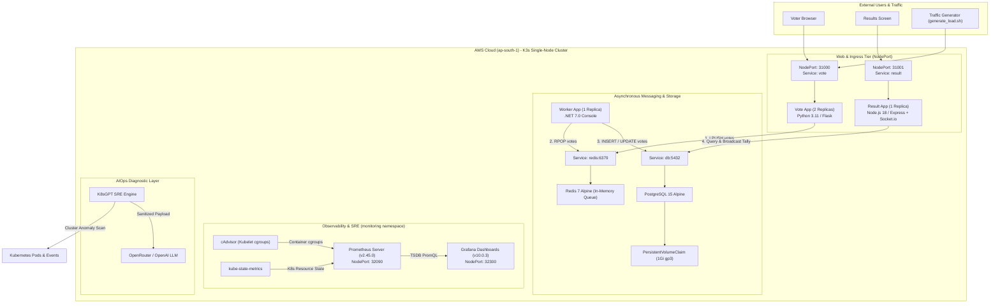
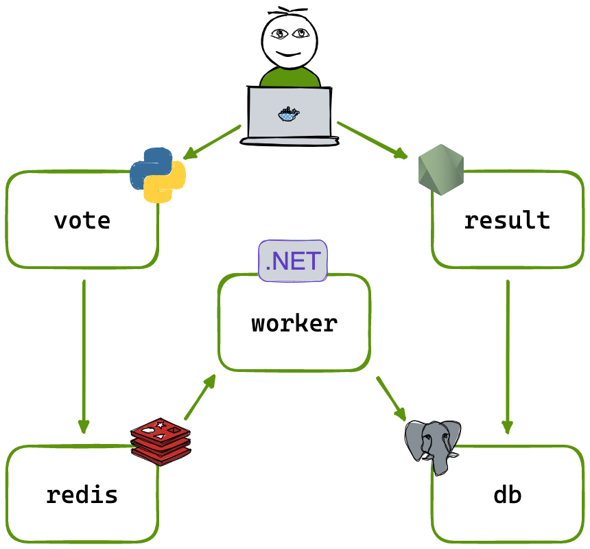

# End-to-End DevOps & GitOps Pipeline: Example Voting App

[](.github/workflows/ci.yaml)
[](docs/phase-2-security-devsecops.md)
[](terraform/)
[](ansible/)
[](k8s/)
[](docs/phase-5-observability-prometheus-grafana.md)
[](docs/phase-6-aiops-k8sgpt.md)

An enterprise-grade, production-modeled DevOps pipeline deploying a distributed polyglot microservices application to AWS using **Infrastructure as Code (Terraform)**, **Automated Configuration Management (Ansible)**, **Kubernetes Orchestration (K3s)**, **Shift-Left Security (Trivy)**, **Full-Stack Observability (Prometheus & Grafana)**, and **AIOps Root Cause Analysis (K8sGPT + LLM)**.

---

## Executive Summary & System Architecture

The voting application is a distributed system designed to demonstrate asynchronous event processing, caching, persistent relational storage, and real-time frontend synchronization across distinct programming runtimes:



### Component Overview

| Service | Runtime / Stack | Exposed Ports | Upstream Dependencies | Storage / State |
| :--- | :--- | :--- | :--- | :--- |
| **`vote`** | Python 3.11-slim (Flask) | Port `80` (NodePort `31000`) | Redis | Stateless (Cookie voter ID) |
| **`redis`** | Redis 7.0 Alpine | Port `6379` (ClusterIP) | None | In-memory queue (`votes`) |
| **`worker`** | .NET 7.0 C# Worker | Background process | Redis, PostgreSQL | Stateless consumer |
| **`db`** | PostgreSQL 15 Alpine | Port `5432` (ClusterIP) | None | 1Gi PVC (`/var/lib/postgresql/data`) |
| **`result`** | Node.js 18-slim (Socket.io) | Port `4000` (NodePort `31001`)| PostgreSQL | Stateless viewer |
| **`prometheus`** | Prometheus v2.45.0 | Port `9090` (NodePort `32090`)| cAdvisor, kube-state-metrics | EmptyDir / ConfigMap TSDB |
| **`grafana`** | Grafana v10.0.3 | Port `3000` (NodePort `32300`)| Prometheus Datasource | Dashboards-as-Code |

---

## Deployment & Engineering Phases

Detailed, phase-by-phase implementation blueprints with verification steps and screenshots:

1. 📦 **[Phase 1: Containerization & CI](docs/phase-1-containerization-ci.md)**
   - Multi-stage Docker builds for Python, Node.js, and .NET.
   - Non-root user permissions and layer caching strategies.
   - GitHub Actions matrix build and container registry packaging.
2. 🛡️ **[Phase 2: Security & DevSecOps](docs/phase-2-security-devsecops.md)**
   - Shift-Left security scanning with Aqua Security Trivy.
   - Static vulnerability analysis of OS and application packages.
   - Automated CVE reporting prior to Docker Hub image publishing.
3. ☁️ **[Phase 3: Infrastructure as Code (Terraform & Ansible)](docs/phase-3-iac-terraform-ansible.md)**
   - Provisioning AWS VPC, EC2 compute (`t3.small`), and security groups via Terraform.
   - Dynamic 4096-bit RSA SSH key pair generation and inventory templating.
   - Idempotent K3s cluster bootstrapping and remote kubeconfig generation via Ansible.
4. ☸️ **[Phase 4: Kubernetes Cluster Deployment](docs/phase-4-kubernetes-deployment.md)**
   - Production manifests: Deployments, Services, Secrets, and PersistentVolumeClaims.
   - Zero-downtime rolling updates and replica management.
   - Verification of active NodePort endpoints across the public AWS host.
5. 📊 **[Phase 5: Observability (Prometheus & Grafana)](docs/phase-5-observability-prometheus-grafana.md)**
   - Real-time kernel and container cgroup metric collection via cAdvisor.
   - Cluster object tracking with `kube-state-metrics`.
   - Workload visualization via Grafana Dashboard 15760 and high-concurrency traffic simulation.
6. 🤖 **[Phase 6: AIOps Incident Diagnosis (K8sGPT)](docs/phase-6-aiops-k8sgpt.md)**
   - Integration of K8sGPT CLI with OpenAI / OpenRouter LLM backends.
   - Automated SRE triage for container crashes (`exitCode=145`) and `CrashLoopBackOff`.
   - Plain-English root cause analysis and automated deployment rollback.

---

## Infrastructure Architecture Diagram



---

## Quickstart Guide

### Option A: Local Testing with Docker Compose
Run the entire distributed application locally in isolated bridge networks:

```bash
# Clone the repository
git clone https://github.com/rahulbastia00/devops-voting-app-pipeline.git
cd devops-voting-app-pipeline

# Start all containers in detached mode
docker compose up -d --build

# Verify container health
docker compose ps
```
- **Vote App:** [http://localhost:5000](http://localhost:5000)
- **Result App:** [http://localhost:5001](http://localhost:5001)

```bash
# Teardown local containers and volumes
docker compose down -v
```

---

### Option B: Cloud Deployment to AWS (Terraform + Ansible + K3s)

#### Prerequisites
- AWS CLI configured with administrator credentials (`aws configure`)
- Terraform `>= 1.5.0`
- Ansible `>= 2.14`
- `kubectl`

#### 1. Provision AWS Cloud Infrastructure
```bash
cd terraform
terraform init
terraform apply -auto-approve
```
*Terraform will output the EC2 Public IP and automatically generate `ansible/inventory.ini` and `terraform/id_rsa`.*

#### 2. Bootstrap K3s Kubernetes with Ansible
```bash
cd ../ansible
ansible-playbook -i inventory.ini playbook.yml
```
*Ansible installs K3s with public TLS SAN and retrieves the configured `k3s-aws.yaml` kubeconfig to the root directory.*

#### 3. Deploy Kubernetes Workloads & Monitoring
```bash
cd ..
export KUBECONFIG=$(pwd)/k3s-aws.yaml

# Deploy storage, data tier, worker, and web apps
kubectl apply -f k8s/00-storage-config.yaml
kubectl apply -f k8s/01-data-tier.yaml
kubectl apply -f k8s/02-worker.yaml
kubectl apply -f k8s/03-web-apps.yaml

# Deploy full-stack observability
kubectl apply -f k8s/06-prometheus-config.yaml
kubectl apply -f k8s/05-grafana-dashboards.yaml
kubectl apply -f k8s/04-monitoring.yaml

# Verify all pods are running
kubectl get pods -A
```

#### 4. Access Live Services
Replace `<EC2_PUBLIC_IP>` with the public IP from Terraform output:
- **Voting Web UI:** `http://<EC2_PUBLIC_IP>:31000`
- **Result Web UI:** `http://<EC2_PUBLIC_IP>:31001`
- **Prometheus Dashboard:** `http://<EC2_PUBLIC_IP>:32090`
- **Grafana Dashboards:** `http://<EC2_PUBLIC_IP>:32300` (Default credentials: `admin` / `admin`)

#### 5. Generate Load & Observe Metrics
```bash
chmod +x generate_load.sh
./generate_load.sh
```

#### 6. Run AIOps Diagnostic Scan
```bash
# Authenticate K8sGPT
k8sgpt auth add --backend openai --model gpt-4o-mini --password "<YOUR_API_KEY>"

# Analyze cluster health in natural language
k8sgpt analyze --explain
```

---

## Teardown & Clean Up

To avoid unnecessary cloud charges, destroy all provisioned AWS resources using Terraform:

```bash
cd terraform
terraform destroy -auto-approve
```
*This command terminates the EC2 instance, releases the dynamic public IP, removes the security group, deletes the generated AWS Key Pair, and wipes local state.*
