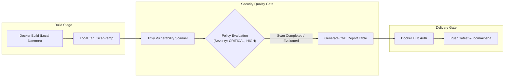
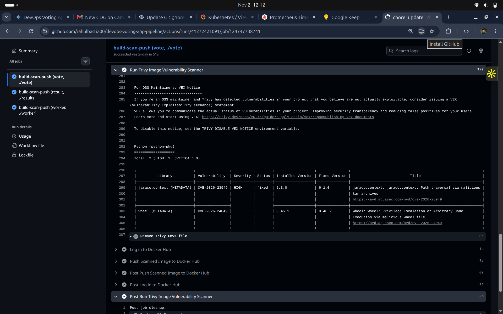

# Phase 2: Security & DevSecOps (Trivy Vulnerability Scanning)

## Architecture & Objective

The objective of Phase 2 is to embed **Shift-Left Security** directly into the automated CI pipeline. By analyzing container layers and software bills of materials (SBOM) before pushing images to public registries, we prevent vulnerable OS packages and third-party runtime libraries from entering production environments.



---

## Security Implementation in CI (`.github/workflows/ci.yaml`)

Trivy (`aquasecurity/trivy-action@master`) is integrated into the GitHub Actions matrix pipeline immediately following local compilation.

### GitHub Actions Step Definition

```yaml
      # Build locally into the runner's Docker daemon without pushing
      - name: Build Local Image for Security Scan
        uses: docker/build-push-action@v5
        with:
          context: ${{ matrix.service.context }}
          file: ${{ matrix.service.context }}/Dockerfile
          load: true
          push: false
          tags: ${{ secrets.DOCKERHUB_USERNAME }}/examplevotingapp_${{ matrix.service.name }}:scan-temp
          cache-from: type=gha
          cache-to: type=gha,mode=max

      # Run Trivy Vulnerability Scan
      - name: Run Trivy Image Vulnerability Scanner
        uses: aquasecurity/trivy-action@master
        with:
          image-ref: ${{ secrets.DOCKERHUB_USERNAME }}/examplevotingapp_${{ matrix.service.name }}:scan-temp
          format: "table"
          exit-code: "0"
          ignore-unfixed: true
          vuln-type: "os,library"
          severity: "CRITICAL,HIGH"
```

### Key Configuration Parameters

| Parameter | Value | Rationale |
| :--- | :--- | :--- |
| `image-ref` | `...:scan-temp` | Scans the freshly generated local image prior to registry deployment. |
| `format` | `table` | Produces human-readable tabular output in the GitHub Actions workflow logs. |
| `ignore-unfixed` | `true` | Filters out upstream vendor issues where no patch currently exists, reducing noise. |
| `vuln-type` | `os,library` | Evaluates base OS packages (Debian/Alpine) and application dependencies (pip, npm, NuGet). |
| `severity` | `CRITICAL,HIGH` | Enforces focus on high-risk vectors while suppressing low/informational findings. |
| `exit-code` | `0` | Audit mode allows monitoring; can be updated to `1` in strict enforcement gates. |

---

## Embedded Scan Evidence

The following screenshot captures the Trivy scanning engine actively analyzing the Python runtime layer of the `vote` service during a production CI execution:



### Observed Scan Analysis

As shown in the execution logs:
- **Component Analyzed:** `Python (python-pkg)` inside the `vote` service image.
- **Detected Vulnerabilities:** 2 HIGH severity CVEs identified in metadata dependencies:
  1. **`CVE-2026-23949` (`jaraco.context`):** High severity path traversal vulnerability via malformed archives.
     - Installed Version: `5.3.0` | Fixed Version: `6.1.0`
  2. **`CVE-2026-24049` (`wheel`):** High severity arbitrary code execution risk via malformed wheel archive handling.
     - Installed Version: `0.45.1` | Fixed Version: `0.46.2`
- **Result:** Findings are reported with authoritative Aqua Security remediation links prior to container registry push, allowing proactive dependency bumping.

---

## Verification & Local Security Commands

To run equivalent vulnerability scans locally before committing code, execute:

```bash
# 1. Install Trivy CLI (Debian/Ubuntu)
sudo apt-get install wget apt-transport-https gnupg lsb-release
wget -qO - https://aquasecurity.github.io/trivy-repo/deb/public.key | gpg --dearmor | sudo tee /usr/share/keyrings/trivy.gpg > /dev/null
echo "deb [signed-by=/usr/share/keyrings/trivy.gpg] https://aquasecurity.github.io/trivy-repo/deb $(lsb_release -sc) main" | sudo tee -a /etc/apt/sources.list.d/trivy.list
sudo apt-get update && sudo apt-get install trivy

# 2. Build local test image
docker build -t rahulbastia/examplevotingapp_vote:local-test ./vote

# 3. Execute Trivy scan against local image
trivy image \
  --severity HIGH,CRITICAL \
  --ignore-unfixed \
  --format table \
  rahulbastia/examplevotingapp_vote:local-test

# 4. Scan repository configuration files for misconfigurations
trivy config ./k8s
```
