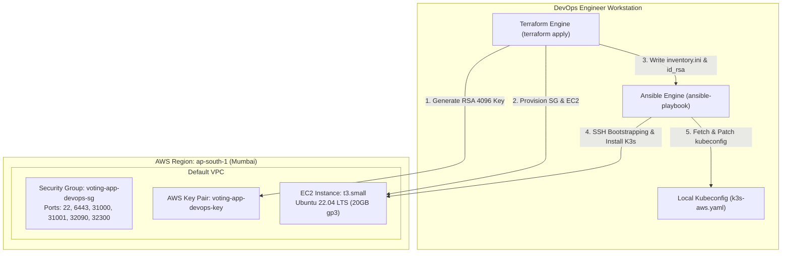

# Phase 3: Infrastructure as Code & Automated Configuration (Terraform & Ansible)

## Architecture & Objective

The objective of Phase 3 is to automate the provisioning and configuration of production-ready cloud infrastructure using **Infrastructure as Code (IaC)** and **Configuration Management**. Terraform provisions the AWS networking and compute footprint, while Ansible automates OS bootstrapping, container runtime configuration, and lightweight Kubernetes (K3s) deployment.



---

## Infrastructure as Code: Terraform (`terraform/`)

The Terraform codebase provides fully deterministic provisioning without requiring pre-existing SSH keys or manual IP management.

### Key Infrastructure Definitions

#### 1. Provider & Dynamic SSH Key Management (`terraform/main.tf`)
```hcl
terraform {
  required_version = ">= 1.5.0"
  required_providers {
    aws   = { source = "hashicorp/aws", version = "~> 5.0" }
    tls   = { source = "hashicorp/tls", version = "~> 4.0" }
    local = { source = "hashicorp/local", version = "~> 2.0" }
  }
}

provider "aws" {
  region = var.aws_region # ap-south-1
}

# Automated SSH Key Pair Generation
resource "tls_private_key" "ssh_key" {
  algorithm = "RSA"
  rsa_bits  = 4096
}

resource "aws_key_pair" "generated_key" {
  key_name   = "${var.project_name}-key"
  public_key = tls_private_key.ssh_key.public_key_openssh
}

resource "local_file" "private_key" {
  content         = tls_private_key.ssh_key.private_key_pem
  filename        = "${path.module}/id_rsa"
  file_permission = "0400"
}
```

#### 2. Network Security Architecture (`terraform/main.tf`)
The security group isolates traffic, exposing only administrative and NodePort service ports:
```hcl
resource "aws_security_group" "k3s_sg" {
  name        = "${var.project_name}-sg"
  description = "Allow inbound SSH, K8s API, and Voting App ports"

  # Port 22: Remote Administration
  ingress {
    from_port   = 22
    to_port     = 22
    protocol    = "tcp"
    cidr_blocks = ["0.0.0.0/0"]
  }

  # Port 6443: Kubernetes API Server
  ingress {
    from_port   = 6443
    to_port     = 6443
    protocol    = "tcp"
    cidr_blocks = ["0.0.0.0/0"]
  }

  # Port 31000: Vote Web App (NodePort)
  ingress {
    from_port   = 31000
    to_port     = 31000
    protocol    = "tcp"
    cidr_blocks = ["0.0.0.0/0"]
  }

  # Port 31001: Result Web App (NodePort)
  ingress {
    from_port   = 31001
    to_port     = 31001
    protocol    = "tcp"
    cidr_blocks = ["0.0.0.0/0"]
  }

  # Port 32090: Prometheus UI (NodePort)
  ingress {
    from_port   = 32090
    to_port     = 32090
    protocol    = "tcp"
    cidr_blocks = ["0.0.0.0/0"]
  }

  # Port 32300: Grafana Dashboard (NodePort)
  ingress {
    from_port   = 32300
    to_port     = 32300
    protocol    = "tcp"
    cidr_blocks = ["0.0.0.0/0"]
  }

  egress {
    from_port   = 0
    to_port     = 0
    protocol    = "-1"
    cidr_blocks = ["0.0.0.0/0"]
  }
}
```

#### 3. EC2 Compute Instance (`terraform/main.tf`)
```hcl
data "aws_ami" "ubuntu" {
  most_recent = true
  filter {
    name   = "name"
    values = ["ubuntu/images/hvm-ssd/ubuntu-jammy-22.04-amd64-server-*"]
  }
  owners = ["099720109477"] # Canonical
}

resource "aws_instance" "k3s_node" {
  ami                         = data.aws_ami.ubuntu.id
  instance_type               = var.instance_type # t3.small
  key_name                    = aws_key_pair.generated_key.key_name
  vpc_security_group_ids      = [aws_security_group.k3s_sg.id]
  associate_public_ip_address = true

  root_block_device {
    volume_size = 20
    volume_type = "gp3"
  }

  tags = {
    Name = "${var.project_name}-cluster"
  }
}
```

#### 4. Automated Ansible Inventory Generation (`terraform/outputs.tf`)
Upon provisioning, Terraform outputs the public IP and generates `ansible/inventory.ini` automatically:
```hcl
output "instance_public_ip" {
  value = aws_instance.k3s_node.public_ip
}

resource "local_file" "ansible_inventory" {
  content = templatefile("${path.module}/inventory.tmpl", {
    ip          = aws_instance.k3s_node.public_ip,
    ssh_keyfile = "${path.module}/id_rsa"
  })
  filename = "${path.module}/../ansible/inventory.ini"
}
```

---

## Configuration Management: Ansible (`ansible/`)

The Ansible playbook (`ansible/playbook.yml`) executes post-provisioning tasks idempotently.

```yaml
---
- name: Setup K3s Cluster Node on AWS EC2
  hosts: k3s_nodes
  become: yes
  tasks:
    - name: Wait for cloud-init and system updates to complete
      ansible.builtin.raw: test -e /var/lib/cloud/instance/boot-finished
      register: cloud_init
      until: cloud_init.rc == 0
      retries: 30
      delay: 5

    - name: Update apt cache and install base packages
      ansible.builtin.apt:
        update_cache: yes
        name:
          - curl
          - apt-transport-https
          - git
        state: present

    - name: Install K3s server with public TLS SAN
      ansible.builtin.shell: |
        curl -sfL https://get.k3s.io | INSTALL_K3S_EXEC="--disable=traefik --tls-san {{ inventory_hostname }} --write-kubeconfig-mode 644" sh -
      args:
        creates: /usr/local/bin/k3s

    - name: Wait for K3s node to be ready
      ansible.builtin.command: /usr/local/bin/kubectl get nodes
      register: k3s_status
      until: '" Ready " in k3s_status.stdout'
      retries: 15
      delay: 5

    - name: Fetch kubeconfig to local machine
      ansible.builtin.fetch:
        src: /etc/rancher/k3s/k3s.yaml
        dest: ../k3s-aws.yaml
        flat: yes

    - name: Update server address in local kubeconfig
      become: no
      delegate_to: localhost
      ansible.builtin.replace:
        path: ../k3s-aws.yaml
        regexp: '127\.0\.0\.1'
        replace: "{{ inventory_hostname }}"
```

### Key Orchestration Steps
1. **Cloud-Init Guard:** Verifies AWS initial initialization has finished prior to running package managers, avoiding apt lock contention.
2. **K3s Server Installation:**
   - `--disable=traefik`: Disables default ingress to save memory and eliminate conflicting port bindings.
   - `--tls-san {{ inventory_hostname }}`: Generates API server certificates containing the public EC2 IP address, enabling secure remote administration via standard `kubectl`.
   - `--write-kubeconfig-mode 644`: Sets read permissions for frictionless local cluster interaction.
3. **Kubeconfig Synchronization:** Transports `/etc/rancher/k3s/k3s.yaml` to the root workspace (`k3s-aws.yaml`) and replaces the loopback binding `127.0.0.1` with the AWS public IP address.

---

## Deployment & Verification Workflow

### Step 1: Provision Cloud Infrastructure
```bash
cd terraform
terraform init
terraform plan
terraform apply -auto-approve
```
*Expected Output:*
```text
Apply complete! Resources: 5 added, 0 changed, 0 destroyed.
Outputs:
instance_public_ip = "15.252.88.7"
```

### Step 2: Bootstrap Node & Cluster via Ansible
```bash
cd ../ansible
ansible-playbook -i inventory.ini playbook.yml
```
*Expected Output:*
```text
PLAY [Setup K3s Cluster Node on AWS EC2] ***************************************
TASK [Wait for cloud-init and system updates to complete] **********************
ok: [15.252.88.7]
TASK [Update apt cache and install base packages] ******************************
changed: [15.252.88.7]
TASK [Install K3s server with public TLS SAN] **********************************
changed: [15.252.88.7]
TASK [Wait for K3s node to be ready] *******************************************
ok: [15.252.88.7]
TASK [Fetch kubeconfig to local machine] ***************************************
changed: [15.252.88.7]
TASK [Update server address in local kubeconfig] *******************************
changed: [15.252.88.7 -> localhost]

PLAY RECAP *********************************************************************
15.252.88.7                : ok=6    changed=4    unreachable=0    failed=0
```

### Step 3: Verify Remote Kubernetes Access
```bash
cd ..
export KUBECONFIG=$(pwd)/k3s-aws.yaml
kubectl get nodes -o wide
```
*Cluster Response:*
```text
NAME               STATUS   ROLES                  AGE   VERSION        INTERNAL-IP     OS-IMAGE             KERNEL-VERSION
ip-172-31-13-81    Ready    control-plane,master   2m    v1.28.2+k3s1   172.31.13.81    Ubuntu 22.04.3 LTS   6.2.0-1017-aws
```
