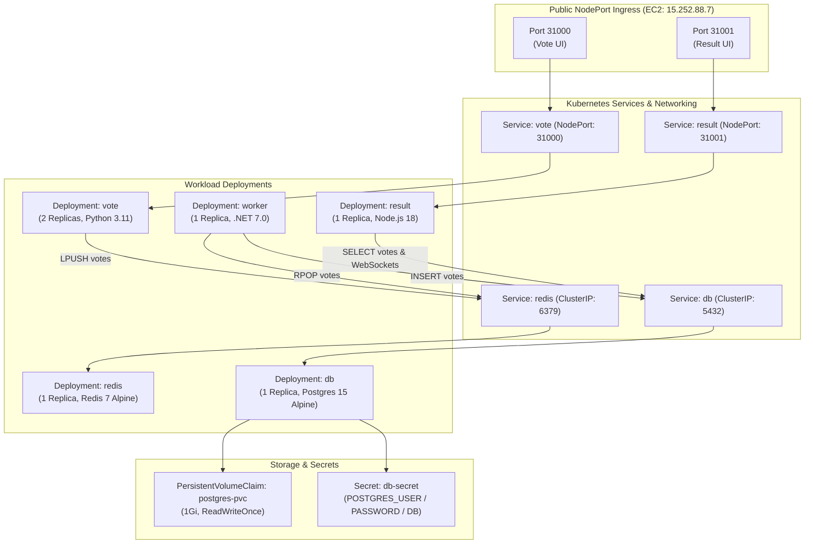
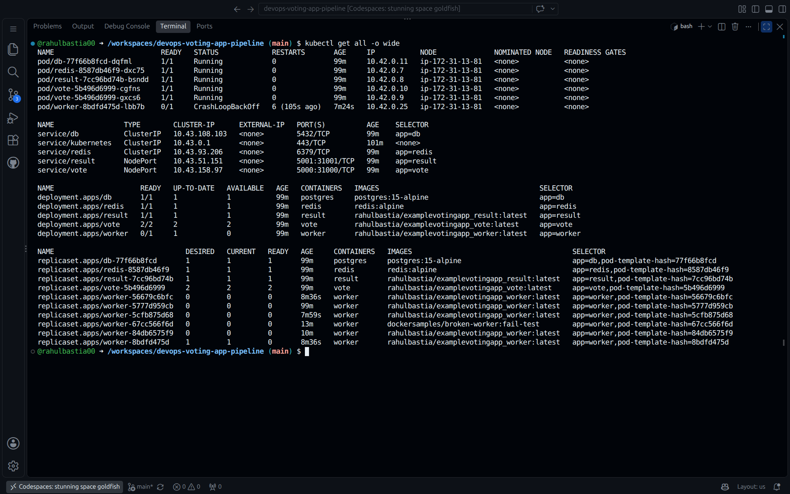
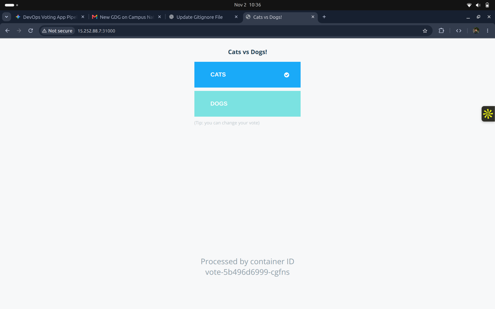
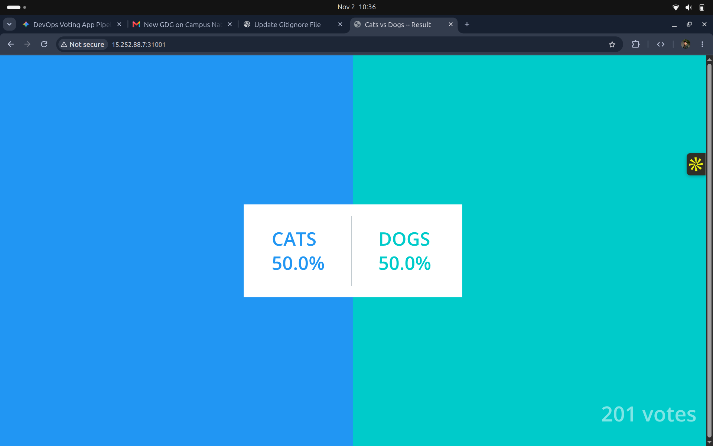

# Phase 4: Kubernetes Application Deployment (K3s Microservices)

## Architecture & Objective

The objective of Phase 4 is to deploy the distributed voting application onto the provisioned K3s Kubernetes cluster. The architecture separates stateful data services, stateless processing engines, and load-balanced web frontends using native Kubernetes primitives.



---

## Kubernetes Manifest Specifications (`k8s/`)

### 1. Storage & Secrets (`k8s/00-storage-config.yaml`)
A PersistentVolumeClaim allocates storage from the K3s host-path dynamic provisioner, while an Opaque Secret safeguards database credentials:

```yaml
apiVersion: v1
kind: PersistentVolumeClaim
metadata:
  name: postgres-pvc
spec:
  accessModes:
    - ReadWriteOnce
  resources:
    requests:
      storage: 1Gi
---
apiVersion: v1
kind: Secret
metadata:
  name: db-secret
type: Opaque
stringData:
  POSTGRES_USER: postgres
  POSTGRES_PASSWORD: postgres
  POSTGRES_DB: postgres
```

### 2. Stateful Data Tier (`k8s/01-data-tier.yaml`)
Configures Redis for queue caching and PostgreSQL with persistent storage:

```yaml
# --- REDIS DEPLOYMENT & SERVICE ---
apiVersion: apps/v1
kind: Deployment
metadata:
  name: redis
  labels:
    app: redis
spec:
  replicas: 1
  selector:
    matchLabels:
      app: redis
  template:
    metadata:
      labels:
        app: redis
    spec:
      containers:
        - name: redis
          image: redis:alpine
          imagePullPolicy: IfNotPresent
          ports:
            - containerPort: 6379
              name: redis
---
apiVersion: v1
kind: Service
metadata:
  name: redis
spec:
  type: ClusterIP
  ports:
    - port: 6379
      targetPort: 6379
  selector:
    app: redis
---
# --- POSTGRES DEPLOYMENT & SERVICE ---
apiVersion: apps/v1
kind: Deployment
metadata:
  name: db
  labels:
    app: db
spec:
  replicas: 1
  selector:
    matchLabels:
      app: db
  template:
    metadata:
      labels:
        app: db
    spec:
      containers:
        - name: postgres
          image: postgres:15-alpine
          imagePullPolicy: IfNotPresent
          envFrom:
            - secretRef:
                name: db-secret
          ports:
            - containerPort: 5432
              name: postgres
          volumeMounts:
            - name: db-data
              mountPath: /var/lib/postgresql/data
      volumes:
        - name: db-data
          persistentVolumeClaim:
            claimName: postgres-pvc
---
apiVersion: v1
kind: Service
metadata:
  name: db
spec:
  type: ClusterIP
  ports:
    - port: 5432
      targetPort: 5432
  selector:
    app: db
```

### 3. Background Processing Worker (`k8s/02-worker.yaml`)
A decoupled background consumer configured with resource requests and limits:

```yaml
apiVersion: apps/v1
kind: Deployment
metadata:
  name: worker
  labels:
    app: worker
spec:
  replicas: 1
  selector:
    matchLabels:
      app: worker
  template:
    metadata:
      labels:
        app: worker
    spec:
      containers:
        - name: worker
          image: rahulbastia/examplevotingapp_worker:latest
          imagePullPolicy: IfNotPresent
          resources:
            requests:
              cpu: 50m
              memory: 64Mi
            limits:
              cpu: 250m
              memory: 256Mi
```

### 4. Stateless Web Frontends (`k8s/03-web-apps.yaml`)
The vote app runs 2 replicas for high availability and load distribution, exposing ports 31000 and 31001 via Kubernetes NodePort services:

```yaml
# --- VOTE APP ---
apiVersion: apps/v1
kind: Deployment
metadata:
  name: vote
  labels:
    app: vote
spec:
  replicas: 2
  selector:
    matchLabels:
      app: vote
  template:
    metadata:
      labels:
        app: vote
    spec:
      containers:
        - name: vote
          image: rahulbastia/examplevotingapp_vote:latest
          imagePullPolicy: IfNotPresent
          ports:
            - containerPort: 80
              name: http
          resources:
            requests:
              cpu: 50m
              memory: 64Mi
            limits:
              cpu: 200m
              memory: 128Mi
---
apiVersion: v1
kind: Service
metadata:
  name: vote
spec:
  type: NodePort
  ports:
    - port: 5000
      targetPort: 80
      nodePort: 31000
  selector:
    app: vote
---
# --- RESULT APP ---
apiVersion: apps/v1
kind: Deployment
metadata:
  name: result
  labels:
    app: result
spec:
  replicas: 1
  selector:
    matchLabels:
      app: result
  template:
    metadata:
      labels:
        app: result
    spec:
      containers:
        - name: result
          image: rahulbastia/examplevotingapp_result:latest
          imagePullPolicy: IfNotPresent
          ports:
            - containerPort: 4000
              name: http
          resources:
            requests:
              cpu: 50m
              memory: 64Mi
            limits:
              cpu: 200m
              memory: 128Mi
---
apiVersion: v1
kind: Service
metadata:
  name: result
spec:
  type: NodePort
  ports:
    - port: 5001
      targetPort: 4000
      nodePort: 31001
  selector:
    app: result
```

---

## Deployment Execution & Cluster Verification

### Applying Manifests in Dependency Order
```bash
export KUBECONFIG=$(pwd)/k3s-aws.yaml

kubectl apply -f k8s/00-storage-config.yaml
kubectl apply -f k8s/01-data-tier.yaml
kubectl apply -f k8s/02-worker.yaml
kubectl apply -f k8s/03-web-apps.yaml
```

### Cluster Resource Status

The state of all pods, services, deployments, and replica sets across the cluster is inspected using `kubectl get all -o wide`:



#### Cluster Inspection Highlights
- **Replication & Scheduling:**
  - Pods `vote-5b496d6999-cgfns` and `vote-5b496d6999-gxcs6` run in parallel across the node.
  - Data stores `db-77f66b8fcd-dqfml` and `redis-8587db46f9-dxc75` are active with assigned internal cluster IPs.
- **Service Bindings:**
  - `service/vote` binds internal port `5000` to NodePort `31000`.
  - `service/result` binds internal port `5001` to NodePort `31001`.
  - Internal discovery names `db` and `redis` enable transparent intra-pod communication.

---

## End-to-End Application Validation

### 1. Vote Interface Verification (`http://<EC2_PUBLIC_IP>:31000`)
Navigating to the public endpoint validates routing to the active container replica (`vote-5b496d6999-cgfns`):



### 2. Result Interface Verification (`http://<EC2_PUBLIC_IP>:31001`)
Casting votes dynamically updates the PostgreSQL database via the Worker queue, visualized in real time on the Node.js frontend:


