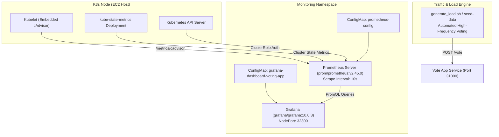
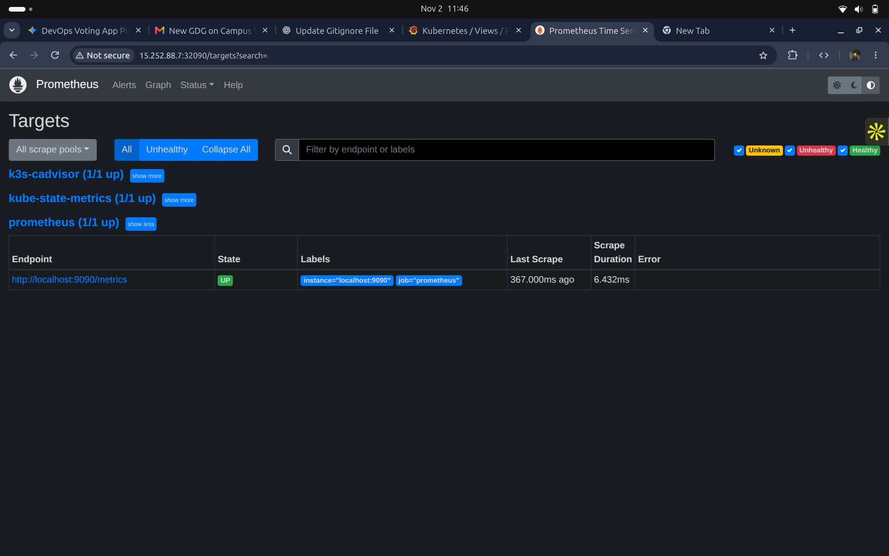
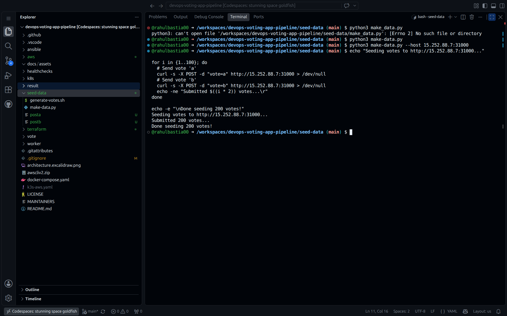
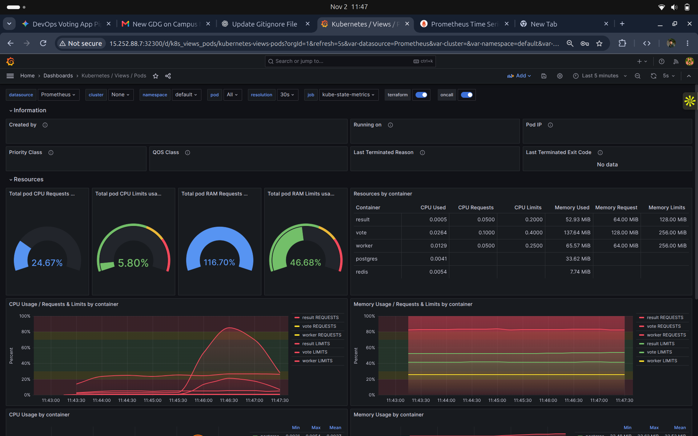
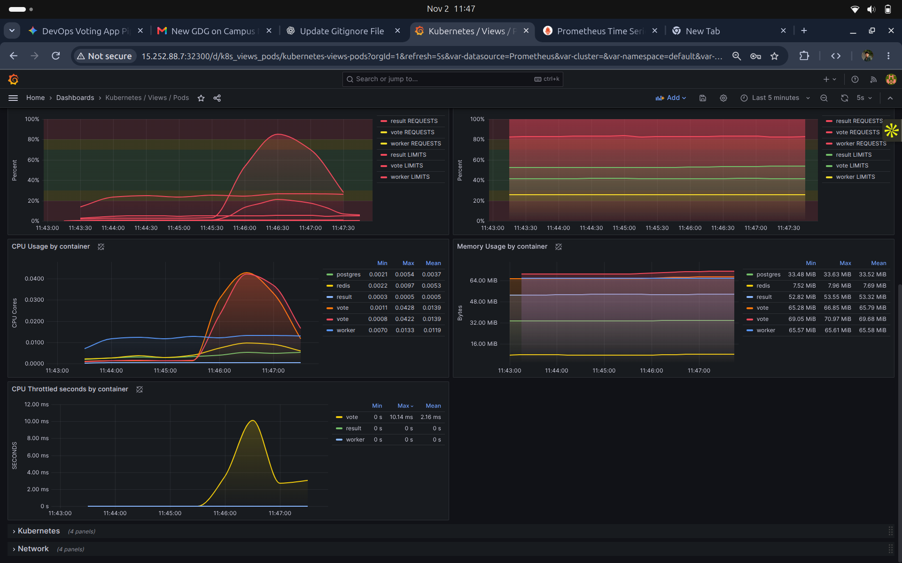

# Phase 5: Observability & Performance Monitoring (Prometheus & Grafana)

## Architecture & Objective

The objective of Phase 5 is to establish full-stack observability across the Kubernetes cluster and microservices. By combining metrics collection from the Linux kernel / cgroups (**cAdvisor**), the Kubernetes API state engine (**kube-state-metrics**), and time-series aggregation (**Prometheus**), we achieve actionable visibility through pre-built and custom **Grafana** dashboards.



---

## Metric Collection & Scrape Configuration (`k8s/`)

### 1. Prometheus Scrape Configuration (`k8s/06-prometheus-config.yaml`)
Prometheus is configured with three distinct jobs:
- **`prometheus`**: Scrapes internal server health and query performance.
- **`kube-state-metrics`**: Collects resource quotas, deployment statuses, replica counts, and container termination states.
- **`k3s-cadvisor`**: Queries the Kubelet proxy over HTTPS using ServiceAccount bearer tokens to retrieve container cgroup utilization (CPU, memory, throttled cycles).

```yaml
apiVersion: v1
kind: ConfigMap
metadata:
  name: prometheus-config
  namespace: monitoring
data:
  prometheus.yml: |
    global:
      scrape_interval: 10s
    scrape_configs:
      - job_name: 'prometheus'
        static_configs:
          - targets: ['localhost:9090']

      - job_name: 'kube-state-metrics'
        static_configs:
          - targets: ['kube-state-metrics.kube-system.svc.cluster.local:8080']

      - job_name: 'k3s-cadvisor'
        scheme: https
        tls_config:
          ca_file: /var/run/secrets/kubernetes.io/serviceaccount/ca.crt
          insecure_skip_verify: true
        bearer_token_file: /var/run/secrets/kubernetes.io/serviceaccount/token
        kubernetes_sd_configs:
          - role: node
        relabel_configs:
          - target_label: __address__
            replacement: kubernetes.default.svc:443
          - source_labels: [__meta_kubernetes_node_name]
            regex: (.+)
            target_label: __metrics_path__
            replacement: /api/v1/nodes/${1}/proxy/metrics/cadvisor
```

### 2. Monitoring Deployment & RBAC (`k8s/04-monitoring.yaml`)
Grants Prometheus permission to query node proxy endpoints and deploys Prometheus and Grafana on designated NodePorts:
- **Prometheus UI:** NodePort `32090`
- **Grafana Dashboard:** NodePort `32300`

---

## Scrape Target Verification

Navigating to `http://<EC2_PUBLIC_IP>:32090/targets` verifies that all target scrape pools are healthy (`1/1 UP`):



### Observed Scrape Pool Health
- **`k3s-cadvisor (1/1 up)`**: Actively capturing kernel-level container cgroup metrics.
- **`kube-state-metrics (1/1 up)`**: Tracking Kubernetes object lifecycles.
- **`prometheus (1/1 up)`**: Tracking internal metric processing latency (~6.4ms scrape duration).

---

## Load Testing & Metric Generation (`generate_load.sh`)

To validate autoscaling triggers, resource quotas, and CPU throttling under real traffic conditions, high-volume concurrent traffic is injected against the Vote service:

```bash
#!/bin/bash
VOTE_URL="http://15.252.88.7:31000"

echo "Starting continuous voting traffic to $VOTE_URL..."
COUNT=0
while true; do
  curl -s -X POST -d "vote=a" "$VOTE_URL" > /dev/null &
  curl -s -X POST -d "vote=a" "$VOTE_URL" > /dev/null &
  curl -s -X POST -d "vote=b" "$VOTE_URL" > /dev/null &
  curl -s -X POST -d "vote=b" "$VOTE_URL" > /dev/null &
  wait
  COUNT=$((COUNT + 4))
  echo -ne "Total live votes dispatched: $COUNT\r"
  sleep 0.2
done
```

### Seeding Automated Votes



Executing batch seed traffic demonstrates rapid queue ingestion across Redis and database persistence via Worker.

---

## Visualizing Telemetry in Grafana (Dashboard 15760)

Grafana Dashboard ID `15760` (*Kubernetes / Views / Pods*) provides granular visualization into resource consumption under synthetic load:



### Telemetry Insights & Resource Consumption
- **Cluster Capacity:** Total pod RAM requests reached `116.70%` of scheduled baselines, while RAM limits utilization remained stable at `46.68%`.
- **Per-Container Footprint:**
  - `vote`: 137.64 MiB RAM, 0.0264 CPU cores.
  - `worker`: 65.57 MiB RAM, 0.0129 CPU cores.
  - `result`: 52.93 MiB RAM, 0.0005 CPU cores.
  - `postgres`: 33.62 MiB RAM, 0.0041 CPU cores.
  - `redis`: 7.74 MiB RAM, 0.0054 CPU cores.

### Granular Container Telemetry & Throttling Analysis



- **CPU Bursts:** During active vote generation, CPU consumption for the Python frontend surged to a peak of `0.0428` cores.
- **CFS Throttling Analysis:** When CPU consumption hit burst thresholds, the Linux Completely Fair Scheduler (CFS) recorded `10.14 ms` of CPU throttling on the `vote` container, proving the efficacy of Kubernetes container resource limits (`cpu: 200m`).
