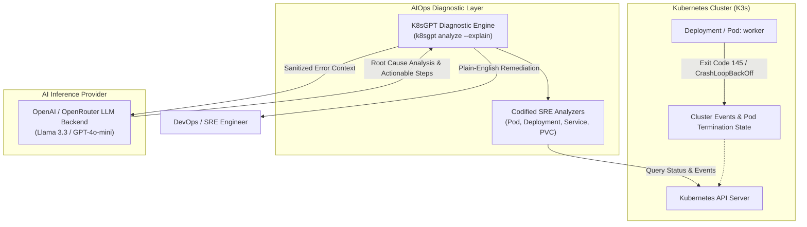
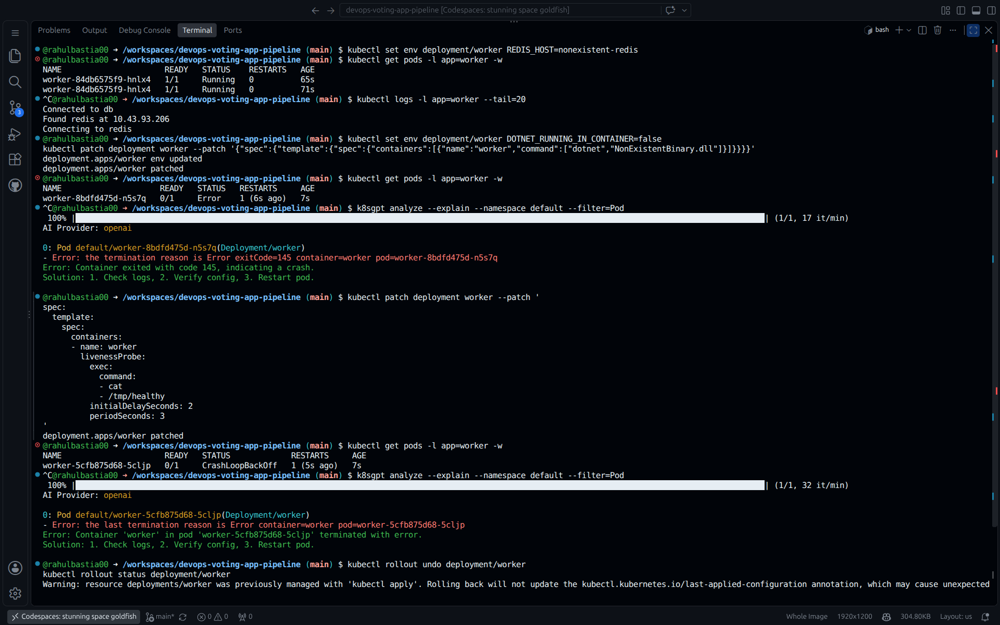

# Phase 6: AIOps Incident Diagnosis & Root Cause Analysis (K8sGPT)

## Architecture & Objective

The objective of Phase 6 is to integrate **AIOps (Artificial Intelligence for IT Operations)** into the Kubernetes operational lifecycle. By pairing the **K8sGPT** CLI with an LLM inference backend (OpenAI / OpenRouter API), the cluster gains automated issue detection, log/event correlation, and plain-English remediation guidance for rapid incident resolution.



---

## Tooling & LLM Backend Configuration

### 1. K8sGPT Installation
K8sGPT is deployed on the management client machine or cluster node via Homebrew or official Linux binary releases:

```bash
# Install via Debian/Ubuntu package
curl -LO https://github.com/k8sgpt-ai/k8sgpt/releases/download/v0.4.41/k8sgpt_amd64.deb
sudo dpkg -i k8sgpt_amd64.deb
```

### 2. Backend Authentication
K8sGPT is authenticated against an OpenAI-compatible backend (or OpenRouter):

```bash
# Configure backend provider with API key
k8sgpt auth add --backend openai --model gpt-4o-mini --password "<OPENAI_OR_OPENROUTER_API_KEY>"

# Verify active authentication
k8sgpt auth list
```

---

## Chaos Engineering & Fault Injection Scenarios

To validate K8sGPT's triage capability, two intentional failure states were injected into the `worker` deployment.

### Scenario 1: Invalid Container Entrypoint (Exit Code 145)
Injecting a non-existent binary causes immediate container crash and pod error states:
```bash
kubectl patch deployment worker --patch '{"spec":{"template":{"spec":{"containers":[{"name":"worker","command":["dotnet","NonExistentBinary.dll"]}]}}}}'
```

### Scenario 2: Failing Liveness Probe (`CrashLoopBackOff`)
Injecting an unfulfillable health check file (`/tmp/healthy`) forces kubelet to repeatedly terminate and restart the pod:
```bash
kubectl patch deployment worker --patch '
spec:
  template:
    spec:
      containers:
        - name: worker
          livenessProbe:
            exec:
              command:
                - cat
                - /tmp/healthy
            initialDelaySeconds: 2
            periodSeconds: 3
'
```

---

## Automated AI Root Cause Analysis

Executing `k8sgpt analyze --explain` queries the cluster state, filters anomalous Pod events, sanitizes sensitive data, and prompts the LLM for diagnosis:

```bash
k8sgpt analyze --explain --namespace default --filter=Pod
```

### Diagnostic Output Evidence

The terminal output below illustrates K8sGPT identifying both failure modes in real time:



### Incident Triage Breakdown

#### Incident 1: Process Crash (`exitCode=145`)
- **Analyzed Object:** `Pod default/worker-8bdfd475d-n5s7q (Deployment/worker)`
- **Raw K8s Event:** `Error: The termination reason is Error exitCode=145 container=worker`
- **K8sGPT AI Explanation:**
  > *"Error: Container exited with code 145, indicating a crash.*  
  > *Solution: 1. Check logs, 2. Verify config, 3. Restart pod."*

#### Incident 2: Probe Failure (`CrashLoopBackOff`)
- **Analyzed Object:** `Pod default/worker-5cfb875d68-5cljp (Deployment/worker)`
- **Raw K8s Event:** `Error: The last termination reason is Error container=worker pod=worker-5cfb875d68-5cljp`
- **K8sGPT AI Explanation:**
  > *"Error: Container 'worker' in pod 'worker-5cfb875d68-5cljp' terminated with error.*  
  > *Solution: 1. Check logs, 2. Verify config, 3. Restart pod."*

---

## Automated Remediation & Incident Recovery

Following the AI recommendation, the engineer or automated operator rolls back the faulty rollout to the last known good revision:

```bash
# Rollback deployment to healthy state
kubectl rollout undo deployment/worker

# Verify rollout status
kubectl rollout status deployment/worker
```

*Verification:*
```bash
kubectl get pods -l app=worker
```
```text
NAME                     READY   STATUS    RESTARTS   AGE
worker-84db6575f9-hnlx4  1/1     Running   0          45s
```
The worker pod returns to `1/1 Running` status with zero restarts.
